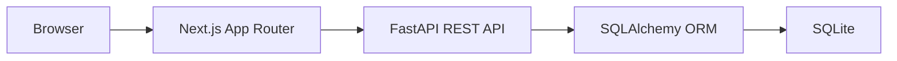

# Architecture

## Overview

Staybnb is split into a FastAPI backend and a Next.js frontend.

## Backend

The backend exposes REST endpoints under `/api/v1`. It uses SQLAlchemy models for persistence, Pydantic schemas for validation/serialization, and Alembic for migrations.

Main areas:

- `app/models`: database entities
- `app/schemas`: request and response contracts
- `app/crud`: data access and business logic
- `app/api/v1`: route handlers
- `tests`: API smoke and behavior tests

## Frontend

The frontend uses the Next.js App Router with server-rendered pages and client components where interaction is needed.

Main areas:

- `src/app`: routes, loading states, error states
- `src/components`: reusable UI and feature components
- `src/lib`: API client, types, utilities, fallback data
- `src/test`: Vitest setup

## Data Flow

1. Server components read URL search params.
2. The typed API client requests listings/categories from FastAPI.
3. UI renders listings and passes interactive needs to client components.
4. Mutations use React Query for cache invalidation and toast feedback.

## Current Mock Auth Strategy

Authentication is intentionally mocked at this stage. Backend endpoints accept `host_id`, `guest_id`, or `user_id` query params. The frontend uses host ID `1` and guest ID `2`.

Future production auth should replace those params with session/JWT-derived user context.
