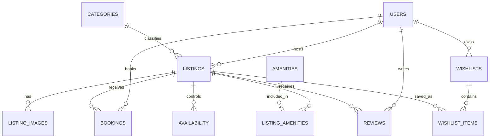

# Database

The project uses SQLite for local development and portfolio deployment simplicity.

## Core Tables

- `users`: guest, host, and admin users
- `categories`: listing categories
- `amenities`: reusable amenity definitions
- `listings`: stay inventory owned by hosts
- `listing_images`: listing photo gallery
- `listing_amenities`: join table between listings and amenities
- `availability`: per-date availability and price overrides
- `bookings`: guest reservations
- `reviews`: guest reviews
- `wishlists`: user wishlist collections
- `wishlist_items`: listings saved to wishlists

## ER Diagram



## Seed Data

Seed data is in:

```text
backend/scripts/seed_db.py
```

It creates categories, amenities, users, listings, sample bookings, reviews, and wishlists.
